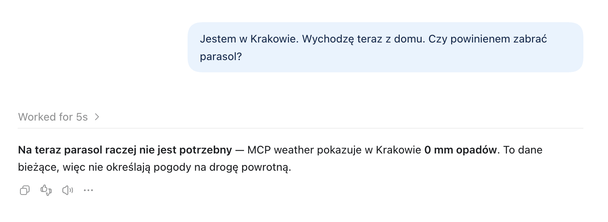

# meteo-mcp

Serwer MCP, który daje Claude'owi i Codexowi dostęp do aktualnej pogody z [Open-Meteo](https://open-meteo.com/) (bez klucza API).

Udostępnia jedno narzędzie, `get_weather`. Przyjmuje współrzędne i zwraca temperaturę, temperaturę odczuwalną, wilgotność, opady, prędkość wiatru oraz informację, czy jest dzień.

## Wymagania

- Node.js 24 z npm. Polecenia `node` i `npm` powinny być dostępne w `PATH`.
- Dostęp do internetu do instalacji zależności i pobierania pogody z API Open-Meteo. Klucz API nie jest wymagany.
- Klient MCP obsługujący transport STDIO, np. Claude lub Codex, do korzystania z narzędzia.

Wersje Node.js i npm sprawdzisz poleceniami:

```bash
node --version
npm --version
```

## Budowanie

```bash
npm install
npm run build
```

Wynik trafia do `dist/server.js`.

## Podłączenie do Claude

Claude Code (uruchom w katalogu projektu):

```bash
claude mcp add weather -- node "$(pwd)/dist/server.js"
```

Claude Desktop: dodaj do `claude_desktop_config.json` i uruchom aplikację ponownie:

```json
{
  "mcpServers": {
    "weather": {
      "command": "node",
      "args": ["/pelna/sciezka/do/meteo-mcp/dist/server.js"]
    }
  }
}
```

## Podłączenie do Codex / aplikacji desktopowej ChatGPT

Poniższe sposoby są alternatywne. Aplikacja desktopowa ChatGPT, Codex CLI i rozszerzenie IDE współdzielą konfigurację MCP dla tego samego lokalnego hosta Codex.

### Przez aplikację ChatGPT

Otwórz **Settings -> Plugins (zakładka Integrations) -> MCPs -> Add MCP server** i wprowadź dane:

* name: `weather`
* type: `STDIO`
* command: `node`
* arguments: `/pelna/sciezka/do/meteo-mcp/dist/server.js` (jeden argument)

Zapisz konfigurację i wybierz **Restart**. Serwery dostępne w rozmowie sprawdzisz poleceniem `/mcp`.

### Przez terminal (Codex CLI)

Po zbudowaniu projektu uruchom w jego katalogu (wymaga zainstalowanego Codex CLI):

```bash
codex mcp add weather -- node "$(pwd)/dist/server.js"
codex mcp list
```

Pierwsze polecenie zapisuje konfigurację w `~/.codex/config.toml`; drugie wyświetla skonfigurowane serwery.

### Przez plik konfiguracyjny

Dodaj do `~/.codex/config.toml`:

```toml
[mcp_servers.weather]
command = "node"
args = ["/pelna/sciezka/do/meteo-mcp/dist/server.js"]
```

Zastąp przykładową ścieżkę pełną ścieżką do zbudowanego pliku. Konfigurację tylko dla projektu możesz umieścić w `.codex/config.toml` w repozytorium; Codex wczytuje ją dla zaufanych projektów. Po zmianach uruchom ponownie lokalnego klienta Codex.

Jeśli aplikacja nie znajduje `node`, podaj pełną ścieżkę do programu w polu `command` (sprawdzisz ją przez `command -v node`).

Instrukcja dotyczy lokalnego Codexa. ChatGPT w przeglądarce nie czyta tych plików; ten serwer udostępnia wyłącznie STDIO.

Źródła: [konfiguracja MCP](https://learn.chatgpt.com/docs/extend/mcp), [ustawienia aplikacji i zakres konfiguracji](https://learn.chatgpt.com/docs/developer-settings).

## Użycie

W Claude i Codex serwer uruchamia klient MCP, więc nie trzeba go startować ręcznie. Wystarczy zapytać Claude'a, np. „Jaka jest pogoda w Warszawie?”. Współrzędne miasta agent ustala sam.


